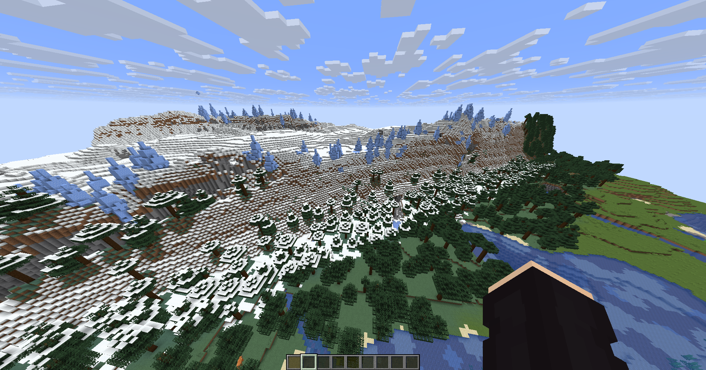
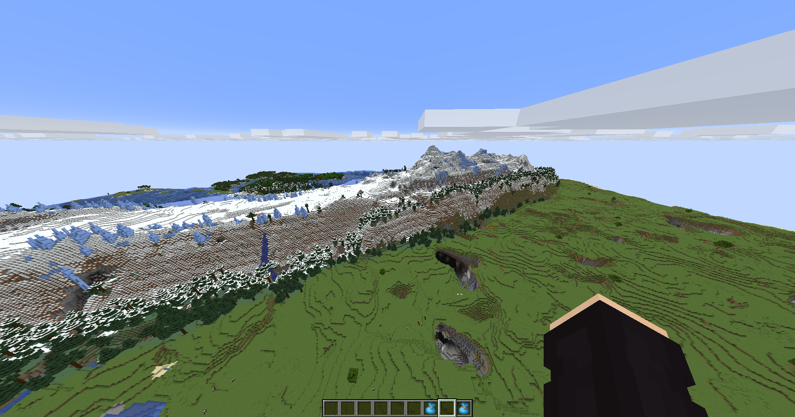
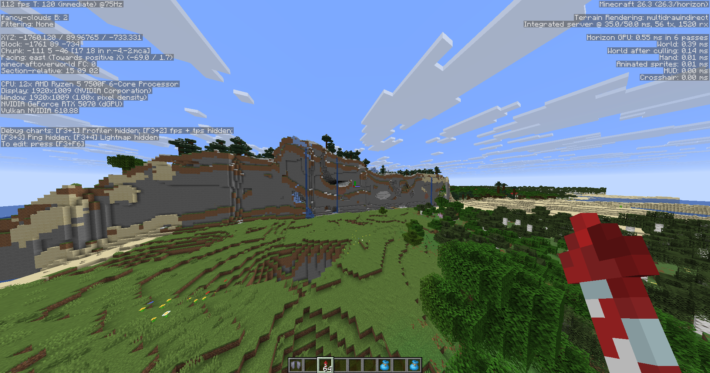
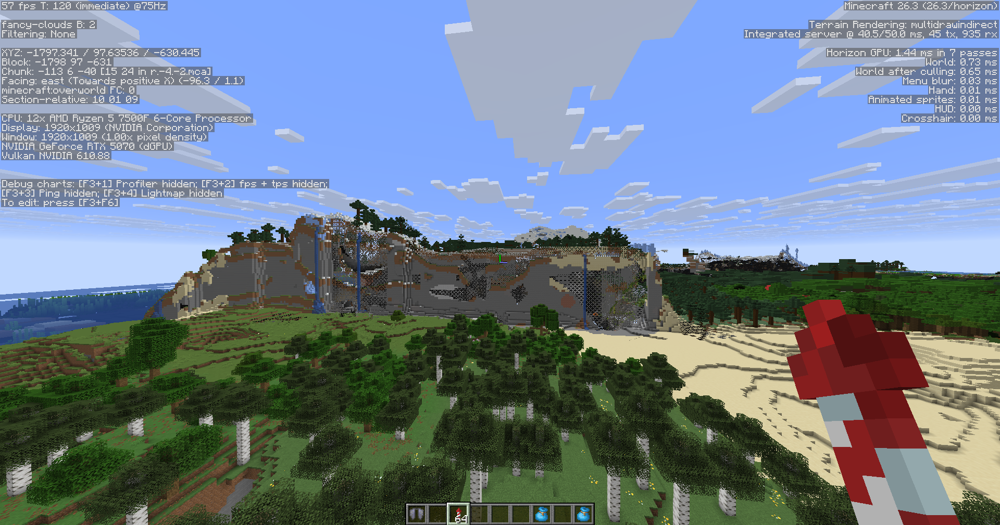
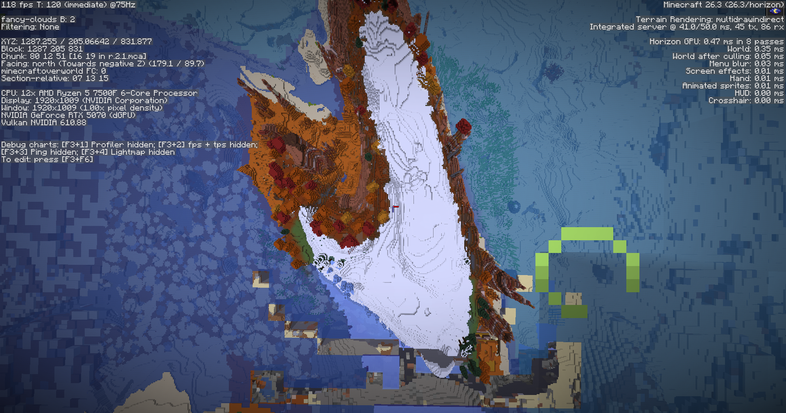
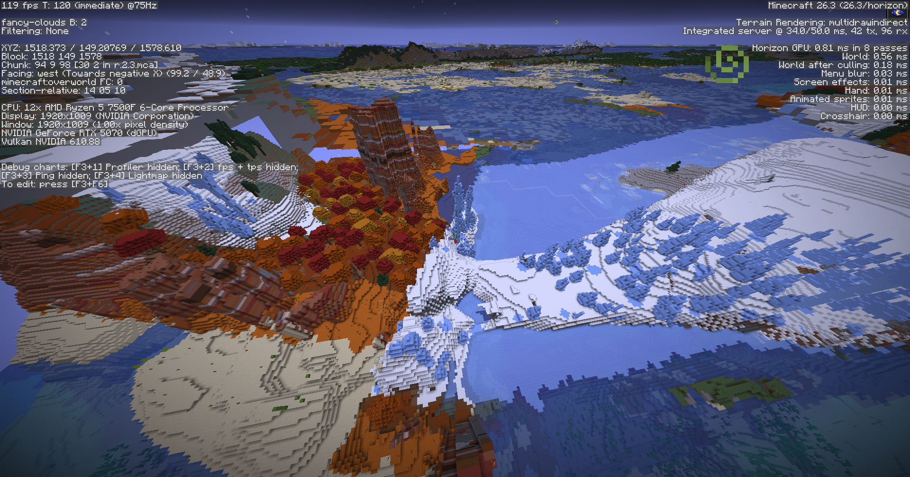

# Итоги первого игрового теста Litospherity

> **Исторический отчёт о тесте №1 (2026-11-07).** Сохранён со скриншотами.
> Тест №2 (К2/высота) прошёл 2026-11-11, тест №3 ещё впереди; актуальное
> состояние — `docs/PLAN-STATUS-2026-11-11.md`, карта документов —
> `docs/README.md`.

<!-- ИСТОРИЧЕСКИЙ / PLAN-STATUS-2026-11-11 -->

---

Источник: обратная связь автора проекта, 2026-11-07.
Обсуждение: https://github.com/Eblanitus/LithoMuchi/issues/7

## Первый игровой тест — 2026-11-07

Отчёт по обратной связи автора проекта (Eblanitus). Это пользовательские наблюдения, а не результаты инструментального профилирования.

### Условия
- Minecraft Java 26.3, Horizon 0.1.0, нативный мод Litospherity 0.1.0.
- CPU: AMD Ryzen 5 7500F; GPU: NVIDIA GeForce RTX 5070 (по F3 на скриншотах).
- Использовались стандартные настройки дальности Horizon; точные значения не записаны.
- Сид пока не предоставлен. Точная ревизия установленного артефакта не зафиксирована.
- Smoke-пак ранее проверен: мир загрузился нормально.
- Scientific: пользователь сообщил о практически неработоспособной генерации и загрузке CPU около 99%. В логе есть вход игрока в мир, поэтому полное зависание создания мира не установлено.
- **Gameplay успешно запущен**, автор летал по миру примерно 20 минут.

## Положительные результаты

Автор очень доволен визуальным результатом:

> «Геймплей запустился и я в восторге в принципе. Меня встретил горный красивый хребет».
>
> «Она сохраняет ванильность и одновременно — огромные просторы и более красивые виды».
>
> «Я человек которого тяжело впечатлить и тут я в тихом насыщении».

Отмечены красивые протяжённые горные хребты, большие пространства, выразительные виды и необычные сочетания рельефа. Автор собрал много интересных моментов за время полёта и оценивает результат как очень достойный.

**Вывод:** первый пользовательский запуск полноценного gameplay-режима подтверждён; визуальное направление получило положительную оценку автора. Это не означает готовность к стабильному релизу.

## Проблемы и вопросы

### 1. Производительность — высокий приоритет

На стандартных настройках дальности Horizon генерация сильно загружает Ryzen 5 7500F. Scientific ранее давал около 99% загрузки CPU; существенная нагрузка отмечена и при тестировании gameplay.

Нужны отдельные замеры генерации новых чанков и дальнего рельефа / LOD, а также проверка повторных вычислений C/E/W/T/H и климата. FPS на отдельных скриншотах не является замером стоимости генерации.

**Требование к оптимизации:** по возможности сохранить текущий визуальный результат и значения генератора; любые приближения оценивать отдельно.

### 2. Длинная плоская стена с открытыми пещерами

На двух скриншотах виден почти плоский протяжённый срез склона с отверстиями пещер. Автор сравнил его с границей чанков, созданных разными версиями генератора, но также допустил естественный обрыв.

- Координаты камеры на кадре: примерно **X −1797, Y 98, Z −630**.
- На другом кадре того же участка: примерно **X −1760, Y 90, Z −733**.
- Это координаты наблюдения, не точные координаты границы.

**Причина не установлена.** Проверить воспроизводимость после перезахода и в новом мире с тем же сидом; привязку к границам чанков; согласованность обычной генерации и LOD; неизменность датапака при создании участков. Не считать дефект доказанным и не объяснять его природой без проверки.

### 3. Островной пояс: меза рядом со снегом и ледяными пиками

Автор обнаружил необычный пояс островов с сочетанием мезы, снежной местности, ледяных пиков и визуально осенней растительности.

- Координаты камеры на одном из кадров: примерно **X 1287, Y 205, Z 832**.
- Дополнительный обзор: примерно **X 1518, Y 149, Z 1579**.

Автор предположил, что это связано с ранее обсуждавшейся заменой холодных сухих зон жаркими ванильными биомами. **Это гипотеза пользователя, не установленная причина.** Точные ID биомов на кадрах не зафиксированы.

Проверить температуру/влажность ядра, преобразование в ванильные параметры и фактический выбор биомов. Отсутствие отдельного ванильного биома «холодная пустыня» само по себе не объясняет появление мезы рядом со льдом.

## План проверки

- [ ] Получить сид мира, точную версию артефакта и значения дальности/LOD.
- [ ] Измерить стоимость генерации чанков и LOD против Horizon без нашего датапака.
- [ ] Проверить и устранить избыточные повторные вычисления полей, сохраняя результат.
- [ ] Воспроизвести стену после перезахода и на новом мире с тем же сидом.
- [ ] Проверить климатические поля и ID биомов в районе мезы/ледяных пиков.
- [ ] Повторить пользовательский тест после исправлений.

## Скриншоты

Оригинальные снимки автора, без изменений. Время указано по именам файлов.

### 2026-11-07_22.39.10

### 2026-11-07_22.42.46

### 2026-11-07_22.45.50

### 2026-11-07_22.47.15

### 2026-11-07_22.57.25

### 2026-11-07_22.58.59

